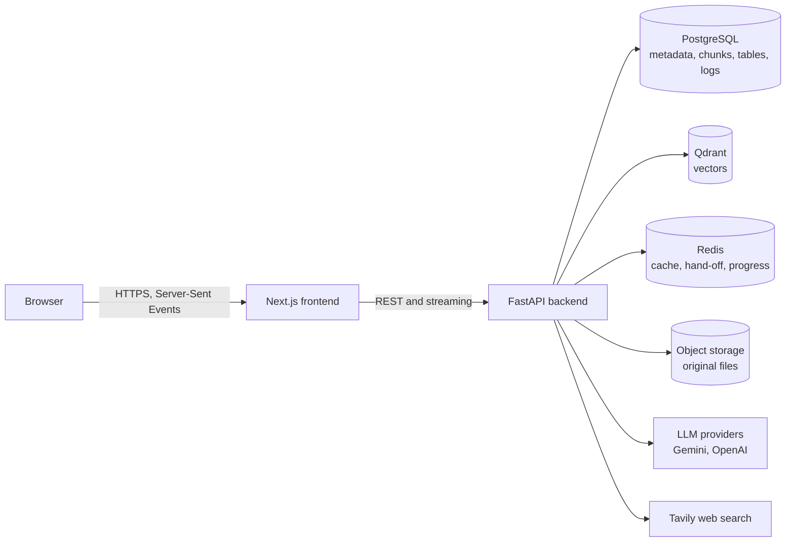

# Aegis RAG

Aegis RAG is a retrieval-augmented generation platform for answering questions from an organisation's own documents. Users upload files or import web pages into knowledge bases, then ask questions in a chat interface. Answers are grounded in the uploaded material, cite the exact passages they rely on, and compute figures from tables exactly rather than estimating them.

The system is a FastAPI backend and a Next.js frontend, backed by PostgreSQL, Qdrant and Redis. It runs locally with Docker Compose and is deployed on managed free-tier services (Hugging Face Spaces, Neon, Qdrant Cloud, Upstash and Cloudflare R2).

## Contents

- [Capabilities](#capabilities)
- [Architecture](#architecture)
- [How a question is answered](#how-a-question-is-answered)
- [How a document is indexed](#how-a-document-is-indexed)
- [Supported file types](#supported-file-types)
- [Exact answers from tables](#exact-answers-from-tables)
- [Roles, access and usage limits](#roles-access-and-usage-limits)
- [Getting started](#getting-started)
- [Configuration](#configuration)
- [Deployment](#deployment)
- [Evaluation and quality](#evaluation-and-quality)
- [Observability](#observability)
- [Security](#security)
- [Testing and CI](#testing-and-ci)
- [Project structure](#project-structure)
- [Known limitations](#known-limitations)

## Capabilities

**Asking questions**

- Hybrid retrieval: dense vector search in Qdrant and keyword (BM25) search, merged with Reciprocal Rank Fusion and reranked with a cross-encoder.
- Answer modes: Quick (two or three sentences), Detailed, and Compare (a side-by-side table across selected documents).
- Scope control: answer from a whole knowledge base or from selected documents only.
- Query decomposition: compound questions are searched as separate sub-questions and the results merged before reranking.
- Exact answers from tables: questions such as "total revenue in March" are answered by a read-only SQL query over the full table, and the query is shown to the user.
- Clickable citations: every `[Source N]` opens the cited passage with its surrounding text; for PDFs the page can be rendered with the passage highlighted.
- Follow-up suggestions, optional web search (Tavily), and a semantic answer cache that reuses confident earlier answers until the knowledge base changes.
- Conversation export to Markdown with footnoted sources, or a print view for PDF.

**Managing documents**

- Upload of more than 30 file types, including scanned documents through OCR (see [Supported file types](#supported-file-types)).
- Import from a URL: web pages are converted to text with tables preserved; links to documents are downloaded and read like uploads.
- Live indexing progress per document, including an estimate of the time remaining.
- Duplicate detection (SHA-256) within a knowledge base.
- An automatic summary and keywords for every indexed document.
- Original files stored on local disk or in S3-compatible object storage (AWS S3, Cloudflare R2, Supabase Storage, MinIO).

**Administration**

- Roles: administrators and members, with server-side enforcement.
- Per-user daily limits on questions and AI tokens, editable per user.
- Analytics: latency, retrieval quality, token usage and estimated cost by day, knowledge base and model.
- Audit log of uploads, deletions, re-indexing, exports, role changes and limit changes.
- Evaluation: RAGAS audits and golden question sets, with a nightly GitHub Actions check.

## Architecture



| Component | Technology | Role |
|---|---|---|
| Frontend | Next.js 16, React 19, Tailwind CSS 4, pdf.js | Chat, document management, analytics and administration screens |
| API | FastAPI, SQLAlchemy (async), Pydantic | Authentication, retrieval, generation, indexing, administration |
| Relational store | PostgreSQL (Neon in production) | Users, knowledge bases, documents, chunks, tables, conversations, query and audit logs |
| Vector store | Qdrant (Qdrant Cloud in production) | One collection per knowledge base, cosine similarity |
| Cache | Redis (Upstash in production) | Semantic answer cache, upload hand-off and progress when a separate worker is used |
| Models | `BAAI/bge-large-en-v1.5` embeddings, `BAAI/bge-reranker-base` reranker | Run locally on CPU inside the API container |
| Generation | Gemini first, then OpenAI | Tried in order, with quota cool-downs and a local extractive fallback |
| Parsing | pdfplumber, python-docx, python-pptx, openpyxl, Tesseract OCR; LlamaParse optional | Text, headings and tables from uploaded files |

PostgreSQL is the source of truth. Every chunk is stored there with its text, page, section and vector point identifier, so a lost Qdrant collection is rebuilt from PostgreSQL automatically on the next start.

## How a question is answered

1. **Usage check.** The user's daily question and token allowance is checked before any model call.
2. **Answer cache.** The first question of a conversation is compared with earlier confident answers in the same knowledge base. A sufficiently similar match is returned immediately.
3. **Classification and decomposition.** The question is checked for whether it needs web results, and compound questions are split into sub-questions.
4. **Retrieval.** Dense and BM25 candidates are fused with Reciprocal Rank Fusion, limited to the selected documents when a scope is set.
5. **Reranking.** A cross-encoder scores each candidate and keeps the best `RERANK_TOP_N`.
6. **Table calculation.** Running in parallel with retrieval: if the question asks for a calculation and a relevant table exists, the result of an exact SQL query becomes the first source.
7. **Prompt construction.** Sources are wrapped as untrusted data and instruction-like text is removed (see [Security](#security)).
8. **Generation.** The answer streams to the browser token by token over Server-Sent Events, with citations.
9. **Scoring and logging.** A confidence score is computed and follow-up questions are drafted, both on a cheaper model, and latency, tokens and cost are written to the query log.

## How a document is indexed

1. **Upload and validation.** The extension is checked against the supported list and the file's signature is verified, so renamed, damaged or password-protected files are rejected with a clear reason.
2. **Parsing.** The file is converted to Markdown, keeping headings and tables. Scanned pages are read with OCR. Parsing runs off the event loop with a time limit.
3. **Summary.** A short summary and keywords are generated for the document.
4. **Chunking.** Chunks follow the document structure. A table is never split mid-row: long tables are split between rows with the header repeated in every piece.
5. **Embedding and upload.** Each chunk is embedded with its document name, summary and section path in front (contextual retrieval). Vectors upload to Qdrant while the next batch is being embedded, and the progress bar shows the time remaining.
6. **Storage.** Chunks and the rows of every table are saved to PostgreSQL in one transaction. If any step fails, the vectors written so far are removed.

Indexing runs inside the API process by default (`INDEXING_MODE=inprocess`). A separate Celery worker is available (`INDEXING_MODE=celery`). In that mode uploads are handed over through Redis and each hand-off key is deleted the moment the worker takes it.

## Supported file types

| Category | Extensions | Notes |
|---|---|---|
| PDF | `.pdf` | Tables detected in reading order; a table continuing onto the next page keeps its header; scanned pages read with OCR |
| Word | `.docx`, `.odt`, `.rtf` | Headings, lists, tables and page numbers |
| Presentations | `.pptx`, `.odp` | One page per slide, with tables, chart data and speaker notes |
| Spreadsheets | `.xlsx`, `.xlsm`, `.xls`, `.ods`, `.csv`, `.tsv` | One table per block on each sheet; percentages and dates as displayed; encoding and delimiter detected |
| Structured text | `.json`, `.xml`, `.yaml`, `.yml` | JSON records become a table |
| Web and e-books | `.html`, `.htm`, `.epub` | Tables preserved; e-book chapters in reading order |
| E-mail | `.eml` | Headers and body; attachments are listed |
| Text | `.txt`, `.md`, `.markdown`, `.rst`, `.log`, `.tex`, `.ini`, `.cfg` | Encoding detected automatically |
| Images | `.png`, `.jpg`, `.jpeg`, `.tif`, `.tiff`, `.bmp`, `.webp`, `.gif` | Text read with OCR |

Legacy `.doc` and `.ppt` files, and Apple Pages, Numbers and Keynote files, are refused with instructions to save them in a supported format. Sheets and CSV files larger than `TABLE_MAX_ROWS` rows (20,000 by default) are indexed up to that limit, and the document states that it was truncated. When `LLAMAPARSE_API_KEY` is set, LlamaParse is used for PDF, Word and PowerPoint files, with the local readers as the fallback.

## Exact answers from tables

Language models are unreliable at adding up long columns from a few retrieved passages. Aegis RAG therefore keeps every table it finds as rows in PostgreSQL (`document_tables`), and answers calculation questions by computation:

1. When a question asks for a total, average, count, maximum, ranking or similar, the most relevant tables are selected.
2. The model is shown their column names, inferred types and sample rows, and writes one SQLite `SELECT`.
3. The query runs on an in-memory copy of only those tables, behind an authorizer that permits reading and nothing else, with a three-second time limit. A failed query is corrected once, using the error message.
4. The exact result is passed to the answering model as the first source. The chat shows a "Calculated exactly from the table data" panel with the result and the query.

Values such as `$1,200`, `4.2%`, `(30)` and `2.5k` are stored as numbers, and ISO dates as dates. A misspelled column name raises an error instead of silently returning zero. Documents indexed before this feature were backfilled from their stored table chunks without re-parsing.

## Roles, access and usage limits

| Area | Members | Administrators |
|---|---|---|
| Chat, Knowledge Bases, Documents, Settings | Yes | Yes |
| Evaluation, Retrieval Viewer | No | Yes |
| Dashboard, Analytics, Users, All Documents, Audit Log | No | Yes |

Restrictions are enforced by the API as well as hidden in the interface: evaluation and retrieval endpoints return `403` to members.

Each user has a daily allowance of questions and AI tokens, reset at midnight UTC. The defaults are `DAILY_QUESTION_LIMIT=100` and `DAILY_TOKEN_LIMIT=300000`, and administrators are unlimited unless given their own limit. Administrators can set a custom limit or no limit for any user on the Users page, which also shows each user's usage for the day. Users see their own usage under Settings. A question beyond the limit is refused with `429` and the time until the reset.

## Getting started

### Prerequisites

- Docker and Docker Compose.
- Optional: a Gemini or OpenAI API key. Without one, answers come from a local extractive fallback.
- Optional: LlamaParse and Tavily keys.

### Run with Docker Compose

```bash
cp .env.example .env
```

Set `SECRET_KEY` in `.env` (generate one with `openssl rand -hex 32`) and add any API keys. Then start the stack:

```bash
docker-compose up --build -d
```

| Service | Address |
|---|---|
| Web application | http://localhost:3000 |
| API documentation | http://localhost:8000/docs |
| Qdrant dashboard | http://localhost:6333/dashboard |

Register an account, create a knowledge base, upload a document and wait for it to show Ready, then open Chat. The first account registered on a new installation becomes an administrator automatically; later accounts are members, and administrators manage roles on the Users page.

### Run without Docker

Backend (Python 3.12; PostgreSQL, Redis and Qdrant must be reachable):

```bash
cd backend
pip install -r requirements.txt
export SECRET_KEY=change-me POSTGRES_SERVER=localhost REDIS_URL=redis://localhost:6379/0 QDRANT_URL=http://localhost:6333
./start.sh
```

Frontend:

```bash
cd frontend
npm install
npm run dev
```

Set `NEXT_PUBLIC_API_URL` in `frontend/.env.local` if the API is not at `http://localhost:8000/api/v1`. OCR for scanned files requires the `tesseract-ocr` system package; both Docker images include it.

## Configuration

All settings are environment variables, documented in `.env.example` and defined in `backend/app/core/config.py`. The most important ones:

| Variable | Default | Purpose |
|---|---|---|
| `SECRET_KEY` | required | Signs access tokens |
| `GEMINI_API_KEY`, `OPENAI_API_KEY` | unset | LLM providers, tried in that order |
| `GEMINI_MODEL`, `OPENAI_MODEL` | `gemini-3.5-flash`, `gpt-4o` | Generation models |
| `QDRANT_URL`, `QDRANT_API_KEY` | local | Vector store |
| `REDIS_URL` | local | Cache and hand-off |
| `STORAGE_BACKEND` | `local` | `s3` for S3-compatible storage, with `S3_BUCKET`, `S3_ENDPOINT_URL`, `S3_ACCESS_KEY_ID`, `S3_SECRET_ACCESS_KEY` |
| `INDEXING_MODE` | `inprocess` | `celery` to index in a separate worker |
| `EMBEDDING_MODEL`, `RERANKER_MODEL` | BGE large, BGE reranker base | Local models |
| `RETRIEVAL_TOP_K`, `RERANK_TOP_N`, `RERANK_SCORE_THRESHOLD` | 15, 5, 0.05 | Retrieval tuning |
| `MAX_UPLOAD_SIZE_MB` | 50 | Upload size limit |
| `TABLE_MAX_ROWS` | 20000 | Rows indexed per sheet or CSV |
| `OCR_ENABLED`, `OCR_LANG`, `OCR_MAX_PAGES` | true, `eng`, 200 | OCR for scanned files and images |
| `TABLE_QA_ENABLED`, `TABLE_QA_MAX_TABLES` | true, 5 | Exact answers from tables |
| `DAILY_QUESTION_LIMIT`, `DAILY_TOKEN_LIMIT`, `ADMINS_UNLIMITED` | 100, 300000, true | Usage limits (0 means unlimited) |
| `ANSWER_CACHE_ENABLED`, `ANSWER_CACHE_SIMILARITY` | true, 0.95 | Semantic answer cache |
| `USE_LITE_MODELS`, `GEMINI_LITE_MODEL`, `OPENAI_LITE_MODEL` | true, `gemini-3.5-flash-lite`, `gpt-4o-mini` | Cheaper models for side tasks, with automatic fallback to the main model |
| `ALERT_EMAIL`, `EMAIL_API_KEY`, `SLACK_WEBHOOK_URL` | unset | Operational alerts by e-mail (Resend) and/or Slack |
| `EMBEDDING_BACKEND` | `torch` (`onnx` in the Space image) | `onnx` runs the same embeddings through ONNX Runtime: identical vectors, about 1.9 times faster on two CPU cores |
| `QUERY_DECOMPOSITION`, `FOLLOW_UP_SUGGESTIONS`, `CONTEXTUAL_EMBEDDINGS` | true | Answer and retrieval features |
| `LLM_PRICING_JSON` | built-in table | Price overrides for cost estimates, in USD per million tokens |
| `LLAMAPARSE_API_KEY`, `TAVILY_API_KEY`, `GOOGLE_CLIENT_ID` | unset | Optional integrations |
| `NEXT_PUBLIC_API_URL` | `http://localhost:8000/api/v1` | Where the browser reaches the API (frontend build) |

## Deployment

The reference deployment uses free tiers of managed services:

| Part | Service |
|---|---|
| Backend | Hugging Face Docker Space, built from `backend/Dockerfile.hfspace` (port 7860, non-root user, models baked into the image) |
| PostgreSQL | Neon |
| Vector store | Qdrant Cloud |
| Redis | Upstash |
| Original files | Cloudflare R2 (`STORAGE_BACKEND=s3`) |
| Frontend | Any Next.js host, for example Vercel |

Secrets are set as Space secrets, never committed. New database columns are added automatically at startup, and missing vector collections are rebuilt from PostgreSQL. The `keepalive.yml` workflow pings the services on a schedule so free tiers are not suspended for inactivity. With a hosted Redis, keep `INDEXING_MODE=inprocess`: an idle Celery worker polls Redis continuously and consumes the provider's command quota.

## Evaluation and quality

- **RAGAS audit.** Faithfulness, answer relevancy, context precision and context recall for a knowledge base, with a heuristic fallback when no model is configured.
- **Golden question sets.** Questions with known correct answers for each knowledge base. They can be drafted automatically from the indexed documents, reviewed, and run on demand. Each run scores correctness, faithfulness and context recall per question and keeps a history.
- **Nightly check.** `.github/workflows/golden-eval.yml` runs every golden set against the deployed API and fails when the average score drops below `GOLDEN_THRESHOLD` (0.7). It needs the repository secrets `AGIS_API_URL`, `AGIS_EMAIL` and `AGIS_PASSWORD` for an administrator account, and can be turned off with the repository variable `GOLDEN_EVAL_ENABLED=false`.
- **Retrieval Viewer.** Shows candidates before and after reranking, with their scores, for any query.

## Observability

Every answered question is recorded in `query_logs` with total, embedding and retrieval latency, retrieval score, hallucination estimate, rating, model, token counts, estimated cost, answer mode and cache status. The Analytics page charts these over time and breaks cost down by day, knowledge base and model. Costs are estimates from a pricing table that can be overridden with `LLM_PRICING_JSON`. The Audit Log records administrative and destructive actions with the acting user.

Operational alerts are sent by e-mail (Resend) and/or to a Slack channel when the server returns an unexpected error, a document fails to index, the database is unreachable at startup, an AI provider runs out of quota, or no provider can answer. Each alert is sent at most once per hour for the same cause. Configure `ALERT_EMAIL` with `EMAIL_API_KEY`, or `SLACK_WEBHOOK_URL`; without either, alerts are written to the log only.

## Security

- **Authentication.** Signed JWTs, with optional Google sign-in. `SECRET_KEY` has no default and the API refuses to start without it.
- **Authorisation.** Every knowledge base, document and conversation request is checked for ownership; administrator-only endpoints are guarded on the server.
- **Prompt injection.** Retrieved text is wrapped as untrusted data and instruction-like phrases are removed before reaching the model.
- **SQL over tables.** Model-written queries run on an isolated in-memory database that contains only the selected tables, under an authorizer that allows reading only, with a time limit.
- **URL import.** Only `http` and `https` addresses are accepted, and private or internal network addresses are refused.
- **Uploads.** Size limits, file signature checks and refusal of password-protected files.
- **Rate limiting.** Requests are rate-limited per client (`RATE_LIMIT`), in addition to the per-user daily limits.

## Testing and CI

```bash
cd backend
pip install -r requirements-test.txt
python -m pytest -q
```

The backend suite covers parsing of every supported file type, chunking, the SQL sandbox and table calculations, usage limits, administrator guards, the indexing pipeline, the answer cache, the prompt-injection guard, URL import and storage. It stubs the machine-learning stack, so it runs in seconds without model downloads.

```bash
cd frontend
npm run lint
npm run build
```

`.github/workflows/ci.yml` runs the backend tests and the frontend lint and production build on every push and pull request.

## Project structure

```
backend/
  app/
    api/v1/          HTTP endpoints: auth, chat, documents, knowledge bases,
                     retrieval, evaluation, analytics, notes
    core/            configuration, database, Redis, startup migrations
    models/          SQLAlchemy models
    schemas/         request and response models
    services/
      extractors.py  readers for every supported file type
      chunking.py    structure- and table-aware chunking
      indexer.py     embedding, vector upload and storage
      search.py      hybrid retrieval and reranking
      table_qa.py    exact answers from tables
      usage.py       daily usage limits
      golden.py      golden question sets
      guard.py       prompt-injection guard
  scripts/           golden evaluation runner for CI
  tests/             unit tests
  Dockerfile         image for Docker Compose
  Dockerfile.hfspace image for Hugging Face Spaces
frontend/
  src/app/           pages: chat, knowledge bases, upload, analytics,
                     evaluation, retrieval, users, audit, settings
  src/components/    shared interface components
  src/lib/           API client and data hooks
.github/workflows/   CI, nightly golden evaluation, keepalive
docker-compose.yml   local stack
```

## Known limitations

- Tables drawn without ruling lines in PDFs are read as text unless LlamaParse is configured.
- Excel files saved by software that does not store calculated values contain empty results for formula cells.
- Embedding runs on CPU. On a two-core host the default model processes roughly one chunk per second with ONNX Runtime, so very large documents take several minutes to index; a smaller embedding model trades a little retrieval quality for speed but requires re-indexing.
- Exact table answers cover one query over up to five tables per question; they do not join data across many workbooks.
- Daily limits apply to chat. Document summaries generated during upload are not counted against a user's allowance.
